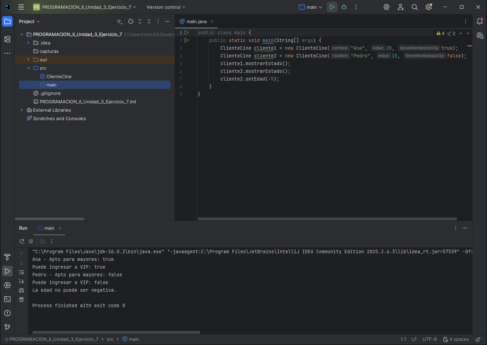

# PROGRAMACIÓN II — Unidad 3, Ejercicio 7: El Control de Acceso a una Sala de Cine VIP

Trabajo práctico de Programación II. Este repositorio contiene la resolución en Java del ejercicio 7 de la Unidad 3.

## Consigna

#### Contexto

Para acceder a zonas exclusivas de un establecimiento, el sistema valida la edad y el estado de la membresía del cliente. Estas reglas de negocio deben estar encapsuladas dentro del dominio del objeto para impedir que entidades externas tomen decisiones de validación incorrectas.

#### Consigna

Modelar una clase en Java que encapsule la información personal de un cliente y evalúe de manera interna su elegibilidad para ciertos servicios restringidos.

#### Desarrollo requerido

- Crear la clase ClienteCine con atributos privados como nombre, edad y tieneMembresiaVip.
- Implementar métodos de validación internos como boolean esAptoParaFuncionMayores() que evalúen los atributos privados de forma encapsulada.
- Ocultar la modificación directa de la edad mediante restricciones en su respectivo setter.
- En el método main, instanciar distintos perfiles de clientes, consultar sus restricciones a través de métodos públicos y mostrar los resultados por consola.

## Estructura del repositorio

```
PROGRAMACION_II_Unidad_3_Ejercicio_7/
├── README.md
├── capturas/
│   └── consola.png
└── src/
    ├── ClienteCine.java
    └── main.java   # clase con el método main
```

## Funcionamiento y lógica

El ejercicio aplica **encapsulamiento** para controlar el acceso a una sala VIP y a funciones para mayores.

### `ClienteCine`

Tiene los atributos privados `nombre`, `edad` y `tieneMembresiaVip`.

- **Constructor:** carga la edad a través de `setEdad()` para que se valide.
- **`setEdad(int)`:** no acepta edades negativas; en ese caso muestra un aviso y conserva la edad anterior.
- **`esAptoParaFuncionMayores()`:** devuelve `true` si el cliente tiene 18 años o más.
- **`puedeIngresarVip()`:** devuelve si el cliente tiene membresía VIP.
- **`mostrarEstado()`:** imprime las dos condiciones de acceso.

### `main`

Crea dos clientes y muestra su estado:

- **Ana**, 20 años, con membresía → apta para mayores y puede entrar a la sala VIP.
- **Pedro**, 15 años, sin membresía → no cumple ninguna de las dos condiciones.

Al final intenta cargarle a Pedro una edad de −5, que se rechaza con el aviso correspondiente.

## Ejecución

Captura de la consola de IntelliJ IDEA ejecutando el programa:



Salida obtenida:

```
Ana - Apto para mayores: true
Puede ingresar a VIP: true
Pedro - Apto para mayores: false
Puede ingresar a VIP: false
La edad no puede ser negativa.
```
